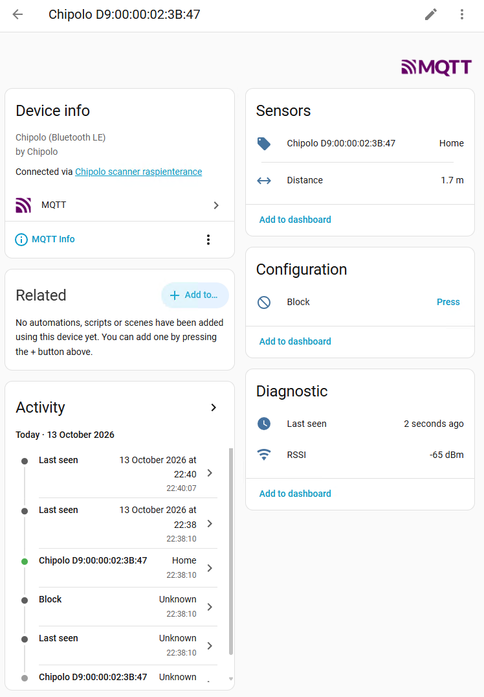
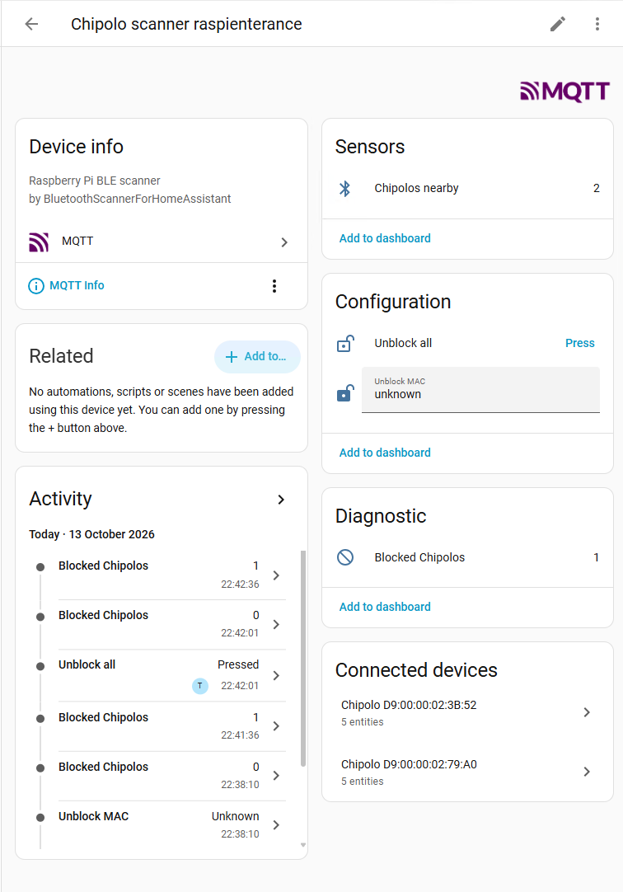
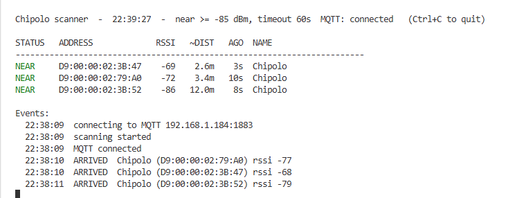
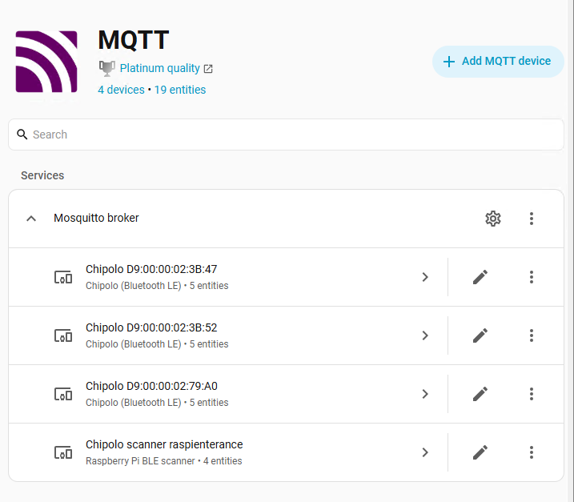

# Bluetooth Chipolo scanner for Home Assistant

Runs on a Raspberry Pi (built-in Bluetooth, no dongle needed), detects nearby **Chipolo**
tags and sends every event to **Home Assistant** over MQTT.

```
Chipolo ──BLE──> Raspberry Pi ──MQTT──> Mosquitto ──> Home Assistant
                 MAC + RSSI only                       you name/label the tags here
```

The Pi only sends technical data (MAC, RSSI, distance, last seen). Every Chipolo it sees
appears automatically as a device in Home Assistant, where you give it a name and area.

Works with the Chipolo app models (ONE, CLASSIC, CARD). The *Spot* models (Apple Find My)
change their MAC address and can't be tracked individually.

## What you get in Home Assistant

Per Chipolo (device "Chipolo D9:00:00:02:3B:47"):



| Entity | Example |
| --- | --- |
| Device tracker | `home` / `not_home` |
| Distance | 1.6 m (rough estimate) |
| RSSI (diagnostic) | -64 dBm |
| Last seen (diagnostic) | 21:59:46 |
| **Block** button (configuration) | hides this Chipolo for good |

Scanner device ("Chipolo scanner raspienterance"):



| Entity | Purpose |
| --- | --- |
| Chipolos nearby | how many tags are `home` right now |
| Blocked Chipolos | count; the MAC list is in the attributes |
| Unblock MAC | type a MAC (`AA:BB:CC:DD:EE:FF`) to unblock it |
| Unblock all | button |

If the Pi goes offline, all its entities become *unavailable* instead of `not_home`.

### Updates sent

- **Arrive / leave**: immediately.
- **RSSI / distance**: at most every 30 s, and only when the signal changed by 3 dBm or more
  (plus a refresh every 5 minutes). Configurable in `config.yaml`.

## 1. Home Assistant setup (one time)

1. **Install the MQTT broker**: *Settings → Add-ons → Add-on store → Mosquitto broker* →
   Install → Start (turn on *Start on boot*).
   (No add-on store? You're running HA Container/Core — run Mosquitto separately, e.g. in Docker.)
2. **Create a user for the scanner**: *Settings → People → Users → Add user*, for example
   `chipolo` with a password. (Enable *Advanced mode* in your profile if the Users tab is hidden.)
3. **Add the MQTT integration**: *Settings → Devices & services*. MQTT is usually found
   automatically after installing Mosquitto — click *Configure*. Otherwise *Add integration →
   MQTT*, broker `core-mosquitto`, port 1883.

## 2. Install on the Pi

On the Pi:

```bash
sudo apt install -y git python3-venv
cd ~
git clone https://github.com/timdows/BluetoothScannerForHomeAssistant.git
cd BluetoothScannerForHomeAssistant
python3 -m venv venv
./venv/bin/pip install -r requirements.txt
cp config.example.yaml config.yaml
nano config.yaml        # fill in Home Assistant IP, user and password
```

Test it (live table, shows `MQTT: connected` at the top):

```bash
./venv/bin/python chipolo_scanner.py
```



Your Chipolos should now appear in Home Assistant under *Settings → Devices & services → MQTT*:



### Run at boot

```bash
sudo cp chipolo-scanner.service /etc/systemd/system/
sudo systemctl enable --now chipolo-scanner
journalctl -u chipolo-scanner -f      # view the log
```

The service file assumes user `pi` and the folder `/home/pi/BluetoothScannerForHomeAssistant`.
Edit it first if yours differ.

### Update to the latest version

```bash
cd ~/BluetoothScannerForHomeAssistant
git pull
./venv/bin/pip install -r requirements.txt
sudo systemctl restart chipolo-scanner
```

Your `config.yaml` and `blocked.json` are not in git, so `git pull` leaves them alone.

## 3. Name, hide or block Chipolos

- **Name / label**: open the device in Home Assistant, click the pencil, set a name
  (e.g. "Keys") and area. Also rename the entity IDs when asked, so automations read nicely.
- **Hide** (keep tracking, just not visible): disable or hide the entity in HA as usual.
- **Block** (unknown/neighbour's Chipolo): press the device's **Block** button, *or* delete
  the device in HA (*⋮ → Delete*) while the scanner is running. The scanner removes it from
  HA and ignores that MAC from then on. Blocked MACs are stored in `blocked.json` on the Pi.
- **Unblock**: type the MAC into *Unblock MAC* on the scanner device, or press *Unblock all*.
  It shows up again the next time it's in range.

## Example automation

```yaml
alias: Keys left the house
triggers:
  - trigger: state
    entity_id: device_tracker.keys
    from: home
    to: not_home
actions:
  - action: notify.mobile_app_my_phone
    data:
      message: "Your keys left the house"
```

You can also add the device tracker to a *Person* (*Settings → People*) so the person is
home when their Chipolo is.

## Command line options

The scanner also works without Home Assistant (no `mqtt:` in the config, or `--no-mqtt`).

| Option | Meaning |
| --- | --- |
| `--config FILE` | config file (default: `config.yaml` next to the script) |
| `--discover` | list every BLE device, to identify a tag |
| `--mac` / `--name` | only watch specific MACs (repeatable) |
| `--near` | RSSI (dBm) needed to count as home. -60 ≈ 1 m, -75 ≈ a few m, -90 ≈ edge of range |
| `--timeout` | seconds without a signal before a tag is `not_home` |
| `--plain` | line-by-line log instead of the live table (used by the service) |
| `--on-arrive` / `--on-leave` | run a local command; `{name}`, `{mac}`, `{rssi}` are filled in |
| `--findmy` | also show Apple Find My tags |

Command line options override `config.yaml`.

## MQTT topics (for debugging)

| Topic | Content |
| --- | --- |
| `chipolo_scanner/status` | `online` / `offline` |
| `chipolo_scanner/<mac>/state` | `{"state":"home","mac":"D9:…","rssi":-64,"distance":1.6,"last_seen":"…"}` |
| `chipolo_scanner/<mac>/block` | Block button |
| `chipolo_scanner/scanner/state` | `{"nearby":2,"blocked":["…"]}` |
| `homeassistant/…/chipolo_scanner/…/config` | discovery configs |

`<mac>` is the MAC in lowercase without colons, e.g. `d90000023b47`.
